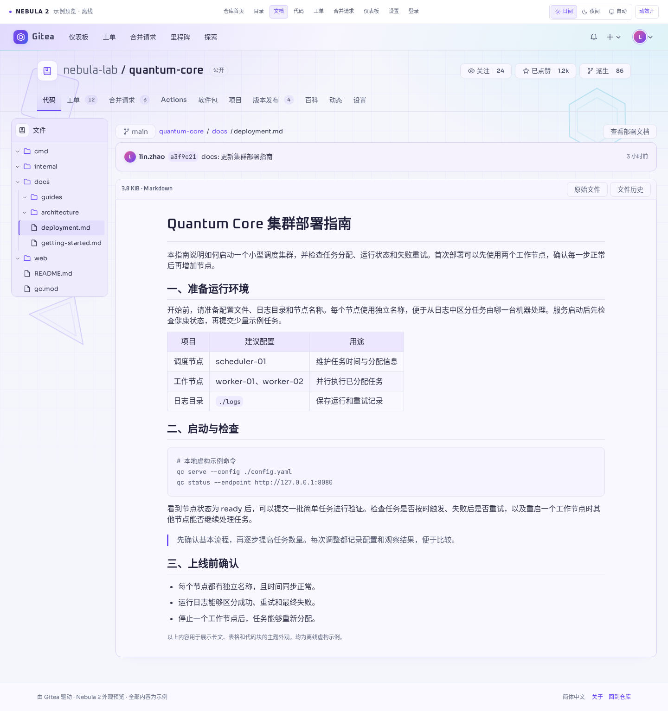
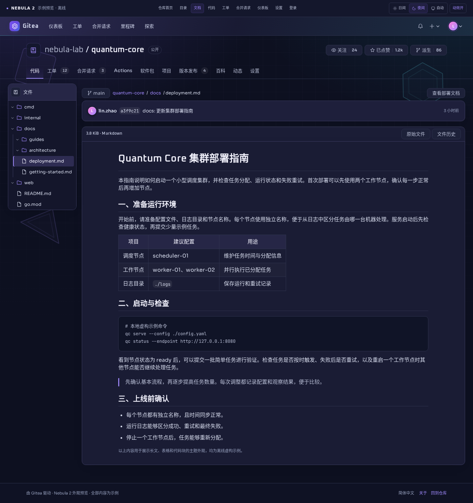

# Nebula · Gitea 主题

以紫蓝渐变、浅色阅读面板和几何漂浮为特色的 Gitea 主题，提供日间、夜间与跟随系统三种模式。

**当前版本：2.1.2 · 适配目标：Gitea 28.2.0 · 生产主题仅使用 CSS**

**[下载完整 ZIP](https://github.com/saladinxp/gitea-nebula-theme/releases/download/v2.1.2/gitea-nebula-2.1.2.zip)** · [English](README.md) · [更新日志](CHANGELOG.md) · [GitHub 版](https://github.com/saladinxp/github-nebula-theme)

## 下载、安装和更新入口

| 需要做什么 | 入口 / 操作 |
| --- | --- |
| 下载当前完整包（v2.1.2） | **[下载 gitea-nebula-2.1.2.zip](https://github.com/saladinxp/gitea-nebula-theme/releases/download/v2.1.2/gitea-nebula-2.1.2.zip)** |
| 查找后续版本 | [最新发布](https://github.com/saladinxp/gitea-nebula-theme/releases/latest) · [全部版本](https://github.com/saladinxp/gitea-nebula-theme/releases) |
| 校验压缩包和单独文件 | [SHA-256 校验清单](https://github.com/saladinxp/gitea-nebula-theme/releases/download/v2.1.2/release-SHA256SUMS.txt) |
| 首次安装到服务器 | 解压完整包，按[首次安装](#首次安装)部署 CSS、字体和配置 |
| 更新已有 Nebula CSS | **[下载更新脚本](https://github.com/saladinxp/gitea-nebula-theme/releases/latest/download/update-nebula-theme.py)** · [更新步骤](#更新已有-nebula) |

完整 ZIP 包含安装说明、字体、离线预览、源码和许可证，下载后先解压。发布页自动生成的 **Source code** 是仓库快照；需要整理好的发行包时，请下载上面有版本号的 ZIP。



## 特点

- 顶栏、仓库文件列表、设置页、首页动态和仓库面板使用协调的紫蓝配色。
- 文件树和正文区域使用稳定底色，背景图形不会穿过文字。
- 两层 CSS 几何图形缓慢漂移；支持系统“减少动态效果”，手机端进一步放慢。
- Oxanium、Sora、JetBrains Mono 三款字体随主题本地加载，不依赖 Google Fonts 网络请求。中文等字符使用系统字体回退。
- 下载项目后，直接打开 `preview/nebula-preview.html` 查看九页面离线演示；全部内容均为虚构示例。



## 兼容性

本版针对 **Gitea 28.2.0** 的组件结构适配。其他 Gitea 版本可能需要调整选择器。浏览器需支持 CSS `color-mix()` 和 `:has()`。

正式主题仅包含 CSS 和字体。离线预览里的 JavaScript、按钮和示例数据不需要安装到 Gitea。主题不改变仓库数据、权限或数据库。

## 首次安装

1. 在 Gitea 管理后台配置页或 `gitea help` 中确认实际 **CustomPath**。启动参数和 `GITEA_CUSTOM` 都可能改变该路径。使用 Docker 时，先核对容器 CustomPath 对应的主机挂载目录。
2. 如果目标位置已有同名文件，先备份到公开资源目录以外。
3. 按下表复制，保留其他主题和资源。

| 本项目内容 | 安装位置 |
|---|---|
| `css/theme-nebula-light.css` | `{CustomPath}/public/assets/css/theme-nebula-light.css` |
| `css/theme-nebula-dark.css` | `{CustomPath}/public/assets/css/theme-nebula-dark.css` |
| `css/theme-nebula-auto.css` | `{CustomPath}/public/assets/css/theme-nebula-auto.css` |
| 完整的 `fonts/nebula/` | `{CustomPath}/public/assets/fonts/nebula/` |

目录通常使用 `755`、静态文件使用 `644`，属主按部署环境设置，确保 Gitea 能读取。CSS 通过 `../fonts/nebula/` 加载字体，因此不要漏传字体目录。

4. 如果 `app.ini` 的 `[ui] THEMES` 已有限制名单，保留原名单并追加 `nebula-light,nebula-dark,nebula-auto`。适配目标版本中，该项为空时允许使用可用主题。试用时可以保留原来的默认主题。
5. 首次安装后重启 Gitea，让它发现新主题。在“个人设置 → 外观”中选择 Nebula，再刷新页面。

如果 Docker 使用 `GITEA__ui__THEMES` 等环境变量，应修改实际生效的配置来源。修改 Compose 环境变量后需要重新创建对应服务，普通重启不会读取新的 Compose 值。

官方说明：[自定义 Gitea](https://docs.gitea.com/administration/customizing-gitea/)、[UI 配置](https://docs.gitea.com/administration/config-cheat-sheet/#ui-ui)、[Docker 配置](https://docs.gitea.com/installation/install-with-docker/#managing-deployments-with-environment-variables)。

## 更新已有 Nebula

下载新版 **[update-nebula-theme.py](https://github.com/saladinxp/gitea-nebula-theme/releases/latest/download/update-nebula-theme.py)**。脚本包含 Nebula 2.0.x 至 2.1.2 的视觉补丁，只依赖 Python 标准库。**必须明确指定 CSS 目录和备份目录**。将下面两个示例路径替换为你自己的实际路径后运行：

```bash
python3 update-nebula-theme.py \
  --css-dir /srv/gitea/custom/public/assets/css \
  --backup-dir /srv/backups/nebula
```

脚本在写入前检查三个已有主题文件，保留最终主题元数据、权限与自定义样式，备份需要修改的原文件。重复运行会跳过已完整应用的补丁。文件缺失、使用软链接或补丁内容被修改时会停止。备份目录必须在公开资源目录之外。

脚本只更新 CSS，不安装缺失字体、不修改配置、不重启服务。更新后在浏览器按 **Ctrl+F5**。首次安装请使用上面的完整安装步骤。

需要回退时，在个人外观设置中切回原主题，或将脚本打印的备份目录中的 CSS 恢复到原位置。

## 构建与预览

构建需要 **Python 3.10+**，无需安装额外依赖。

```bash
python3 build-theme.py
python3 build-theme.py --check
python3 package-theme.py
```

修改 `src/` 后重新构建。构建器核对随包 Gitea 参考源码的校验值，生成三份主题和包含字体的离线 HTML。打包器仅收录明确列入公开文件清单的文件，并生成 `SHA256SUMS`。

离线演示用于查看外观，并非真实运行的 Gitea。安装后请在自己的实例检查常用页面。

## 动效

桌面端两层几何图形分别为 18 秒、22 秒一轮；手机端为 32 秒。网格、正文和面板保持静止。系统启用“减少动态效果”后图形停止移动，离线演示也提供动效开关。

## 来源与许可

维护者：[saladinxp](https://github.com/saladinxp)。本项目是社区主题，与 Gitea 官方无隶属关系。

Gitea 参考 CSS 保留上游 MIT 许可；三款字体保留各自的 SIL Open Font License。组件许可不代表对 Nebula 全部源码的统一授权。当前许可状态及文件位置见 [LICENSING.md](LICENSING.md)。
